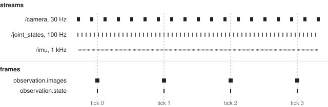
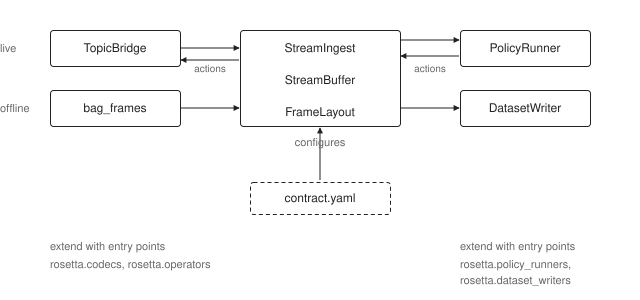

# About the contract

What is the contract and what can it do for you?

## Streams and frames

A ROS 2 robot publishes topics. Each has its own message type, its own rate,
and its own clock. A policy doesn't consume topics. It consumes frames at regular intervals. At
every tick, one array per key, always the same keys, always the same shapes.



Turning topics into frames means deciding which data from your streams belongs to which fields, and at which tick of a frame.
The contract provides `align`, `select` and `apply` to define the time, shape, and value components of the transform from stream to frame.

## Before or after recording

LeRobot's `Robot` class makes those decisions in code. `get_observation()`
hands back a frame. This is nice because it is compact, and ready to train on.
But anything the class didn't emit is gone. Want a
different image size, one more joint, a different alignment rule? You might be stuck re-recording.

Rosetta makes the decisions after recording. You record your data raw, as bags, with every message
at its own rate and stamp, on every topic. The contract enforces transforms only in preparation for training, and again when you run the policy. If you change it, you prepare and train again.

## The same code, twice

Two copies of one transform risk drifting apart. Say data preparation
resizes with one library and inference uses another. Nothing crashes. The
policy will likely just perform a little worse than it should.

So both paths run the same three classes. `StreamIngest` reads a message on
its timeline, selects the fields and applies the operators. `StreamBuffer`
picks the sample for each tick. `FrameLayout` lays the values out under
their keys. Offline, `bag_frames` feeds them from a bag. Live, `TopicBridge`
feeds them from subscriptions.



A test in `rosetta_ros` (`test_bag_live_parity.py`) feeds the same messages
through `StreamBuffer` and `FrameLayout` by hand and checks the porter's
output against them frame for frame. One caveat: a stream aligned on
`receive` uses the bag's receive stamp offline and the node clock live, so it
replays closely, not exactly. A stream aligned on `header` replays bit for
bit.

Actions go the other way, live only. `FrameLayout` splits the action vector,
the operators run in reverse, and an encoder builds the message.

## Where the contract stops

At the dataset. Frames come out in robot units, named and shaped the way the
dataset stores them. Normalization, batching and tokenization are the
framework's job and travel with the checkpoint. LeRobot saves its processors
next to the weights. So the contract keeps the robot side the same between
building and serving, and the checkpoint keeps the model side the same.

The contract also travels with the data. The recorder writes it into each
bag's metadata, and the porter writes the contract it was given into the
dataset (LeRobot's writer puts it at `meta/rosetta_contract.yaml`). A policy
runner started without a contract path follows the checkpoint back to its
training dataset and reads the contract there.

## Robot interfaces and framework adapters

The robot side turns a robot's middleware into frames. The policy side turns
frames into a dataset or into actions. Each side is a separate package that
plugs into the core package `rosetta`, which imports neither.

```text
robot  ──  middleware  ──  Rosetta  ──  framework  ──  policy
           (ROS 2)                      (LeRobot)
```

Each side is named after its endpoint: the robot on one side, the policy on
the other. What plugs in on a side adapts to whatever that endpoint runs on.
A robot interface adapts a middleware, and a framework adapter adapts a
learning framework. LeRobot is a framework, not a policy: its one adapter
serves every policy type LeRobot's async inference supports, read from the
checkpoint it loads. The same names organize the code and the repository:
`rosetta.robots` and `robots/<middleware>/` on the robot side,
`rosetta.policies` and `policies/<framework>/` on the policy side.

A robot interface such as `rosetta_ros` registers under
`rosetta.robot_interfaces`, named after the `robot_interface` value contracts
use. Loading a contract asks that interface which message types exist, which
timelines each carries and whether a `qos` parses, so a contract for an
interface that isn't installed fails to load. A framework adapter such as
`lerobot_rosetta` registers a dataset writer and a policy runner. Under ROS 2,
`rosetta_port` joins the two sides offline and `policy_runner_node` joins
them live, each looking the framework up by name.

The two sides mostly stay apart. `rosetta_ros` never imports a framework.
The exception is `lerobot_rosetta`: its policy runner drives LeRobot's
`RobotClient` with the LeRobot `Robot` plugin as the robot, and that plugin is
built on `rosetta_ros`. So importing `lerobot_rosetta`, even for its dataset
writer, imports ROS.

Entry points extend this. `rosetta.robot_interfaces` adds a middleware,
`rosetta.codecs` adds message types, `rosetta.operators` adds value
transforms, `rosetta.dataset_writers` and `rosetta.policy_runners` add a
framework. A contract names its robot interface, message types and operators
but never a framework.

## One numeric key on the live path

The porter writes one dataset feature per contract key. LeRobot's live path
does not: its feature builder produces one `observation.state` for all numeric
observations and one `action` for all actions. A contract with two numeric
observation keys, or two action keys, ports and trains fine, then fails when
the robot connects.

Rosetta checks this where LeRobot is involved, in the `Robot` plugin's
`connect()` and in the policy runner's configure step. The same check refuses
a numeric stream without `select`, because the live path names its features
after the selected fields. The contract loader doesn't check it, since the
contract isn't tied to LeRobot. If you hit the limit, merge the streams into
one multi-source key.

## Unstamped messages

A message aligned on `header` with a stamp of `(0, 0)` is dropped. Rosetta
doesn't fill in the arrival time. If it did, a driver that forgets to stamp
would look fine in a dataset and behave differently live. The drop is logged
once, and so is recovery. A message honestly stamped at the epoch is lost
too.
