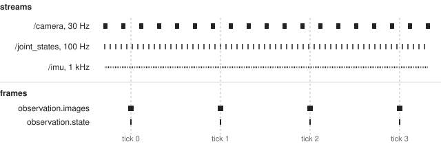
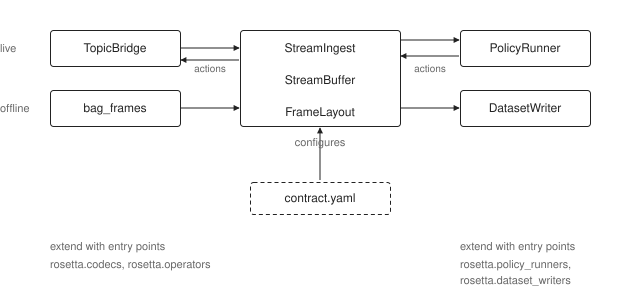

# About the contract

What is the contract and what can it do for you?

## Streams and frames

A ROS 2 robot publishes topics. Each has its own message type, its own rate,
and its own clock. A policy doesn't consume topics. It consumes frames at regular intervals. At
every tick, one array per key, always the same keys, always the same shapes.



Turning topics into frames means deciding which data from your streams belongs to which fields, and at which tick of a frame.
The contract provides `align`, `select` and `apply` to define the time, shape, and value components of the transform from stream to frame.

## Before or after recording

LeRobot's `Robot` class makes those decisions in code. `get_observation()`
hands back a frame. This is nice because it is compact, and ready to train on.
But anything the class didn't emit is gone. Want a
different image size, one more joint, a different alignment rule? You might be stuck re-recording.

Rosetta makes the decisions after recording. You record your data raw, as bags, with every message
at its own rate and stamp, on every topic. The contract enforces transforms only in preparation for training, and again when you run the policy. If you change it, you prepare and train again.

## The same code, twice

Two copies of one transform risk drifting apart. Say data preparation
resizes with one library and inference uses another. Nothing crashes. The
policy will likely just perform a little worse than it should.

So both paths run the same three classes. `StreamIngest` reads a message on
its timeline, selects the fields and applies the operators. `StreamBuffer`
picks the sample for each tick. `FrameLayout` lays the values out under
their keys. Offline, `bag_frames` feeds them from a bag. Live, `TopicBridge`
feeds them from subscriptions.



A test in `rosetta_ros` (`test_bag_live_parity.py`) feeds the same messages
through `StreamBuffer` and `FrameLayout` by hand and checks the porter's
output against them frame for frame. One caveat: a stream aligned on
`receive` uses the bag's receive stamp offline and the node clock live, so it
replays closely, not exactly. A stream aligned on `header` replays bit for
bit.

Actions go the other way, live only. `FrameLayout` splits the action vector,
the operators run in reverse, and an encoder builds the message.

## Where the contract stops

At the dataset. Frames come out in robot units, named and shaped the way the
dataset stores them. Normalization, batching and tokenization are the
framework's job and travel with the checkpoint. LeRobot saves its processors
next to the weights. So the contract keeps the robot side the same between
building and serving, and the checkpoint keeps the model side the same.

The contract also travels with the data. The recorder writes it into each
bag's metadata, and the porter writes the contract it was given into the
dataset (LeRobot's writer puts it at `meta/rosetta_contract.yaml`). Started
without a contract path, `policy_runner_node` asks its policy runner where a
checkpoint keeps its contract. LeRobot's runner follows the checkpoint back
to its training dataset and reads the contract there.

## Robots, data and policies

Three kinds of package plug into the core package `rosetta`. A robot
interface turns a robot's middleware into frames. A dataset backend turns
frames into training data, or reads training data back as frames. A policy
runner turns frames into actions on a live robot. Core imports none of them.

```text
robot ── middleware ── Rosetta ─┬─ data ───── dataset  (LeRobot, Rerun)
         (ROS 2)                └─ policies ─ policy   (LeRobot)
```

Data and policies are separate because they are separate choices. A LeRobot
policy can train from a LeRobot dataset that `rosetta_port` wrote, or from
`.rrd` recordings that `rerun_rosetta` reads straight off a Rerun catalog
server, with no dataset written at all. If one package had to provide both
halves, Rerun would need a policy runner it has no use for, and porting to a
LeRobot dataset would pull in the gRPC and inference dependencies of
LeRobot's runner. So LeRobot ships two packages: `lerobot_dataset_rosetta`
writes its dataset format and `lerobot_rosetta` runs its policies. LeRobot
is a framework, not a policy: its one runner serves every policy type
LeRobot's async inference supports, read from the checkpoint it loads.

The same three names organize the code and the repository:
`rosetta.robots` and `robots/<middleware>/`, `rosetta.data` and
`data/<format>/`, `rosetta.policies` and `policies/<framework>/`.
`robots/<middleware>/` holds a middleware's robot interface and the
packages that come with it, such as the ROS 2 nodes and message
definitions. `policies/<framework>/` holds everything for running that
framework live on a Rosetta robot: its policy runner, and the plugins its
own tools load to drive the robot. So `policies/lerobot/` also holds
LeRobot's `Robot` and `Teleoperator` plugins. Neither provides a robot
interface. They expose a Rosetta robot to LeRobot's command-line tools, its
async inference client and its teleoperation tools, and the LeRobot policy
runner is built on the `Robot` plugin.

A robot interface such as `rosetta_ros` registers under
`rosetta.robot_interfaces`, named after the `robot_interface` value contracts
use. Loading a contract asks that interface which message types exist, which
timelines each carries and whether a `qos` parses, so a contract for an
interface that isn't installed fails to load. A dataset writer registers
under `rosetta.dataset_writers` and a policy runner under
`rosetta.policy_runners`. Under ROS 2, `rosetta_port` hands frames to a
writer offline and `policy_runner_node` hands them to a runner live, each
looking it up by name.

The packages stay apart. `rosetta_ros` never imports a framework, and no
data or policy package imports ROS. When a framework hosts the run itself, as
LeRobot's own command-line tools do with the LeRobot `Robot` plugin, the
plugin opens the robot through the contract's robot interface
(`RobotInterface.connect`) and gets the same `FrameIO` a ROS host would hand
a policy runner. When a reader decodes recordings itself, as `rerun_rosetta`
does, the robot interface tells it how its recordings are laid out (a
`rerun_rosetta.layouts` entry point) and the reader decodes them with the
codecs that interface registered. Running a `ros2` contract still needs
`rosetta_ros` installed, because loading the contract asks it.

Inside core the same rule holds as layers. Base modules (errors, plugin
loading, the codec and operator registries) sit under the contract, the
contract sits under frames, and `rosetta.robots`, `rosetta.data` and
`rosetta.policies` sit on top, importing the lower layers and never each other.
A test, `rosetta/test/test_layering.py`, reads every core import and fails on
one that points up a layer, crosses between the three, or closes a cycle.

Entry points extend this. `rosetta.robot_interfaces` adds a middleware,
`rosetta.codecs` adds message types, `rosetta.operators` adds value
transforms, `rosetta.dataset_writers` adds a dataset format,
`rosetta.frame_readers` adds a recording format to train from, and
`rosetta.policy_runners` adds a policy framework. A contract names its robot
interface, message types and operators but never a dataset format or a
framework.

A frame's arrays are numpy, with one exception: a value a transport
delivered in device memory. A ROS 2 Lyrical image or `ExperimentalTensor`
from a CUDA publisher arrives that way when the policy runner's
`buffer_backends` asks for it and the stream's decoder and operators handle
device memory. The value stays on its device through decode and `resize`, and
Rosetta reads it only through DLPack, so core never imports its array
library. Where it goes next is the policy runner's call, the same as
moving data to the model's device always was. LeRobot's observations are
numpy, so its runner copies each contract-sized image to the host once per
frame, and it has no way to declare a tensor. A runner for a framework that
takes device arrays would hand either one over where it is.

## Port first, or read while training

Training data can take the contract at two times. A dataset writer applies
it once, at port time: `rosetta_port` decodes, selects, transforms and
resamples every bag and writes the result, and LeRobot's `lerobot-train`
reads finished files. By the time training runs, every contract decision is
baked into them, and Rosetta isn't in the training process at all. A
dataset reader applies it at training time instead: it reads the
recordings and serves contract frames as the trainer asks for them. Change
the contract and the next run sees it, with nothing to port again.

Training itself stays the framework's either way. The optimizer, the loss,
normalization and checkpoints belong to LeRobot, and a contract stops at the
data ([Where the contract stops](#where-the-contract-stops)). What changes is how the framework meets
Rosetta. With a writer they meet at a file format. With a reader they meet
inside the training process, at the framework's dataset API: for LeRobot,
the windows each policy's config asks for, `<key>_is_pad` at episode edges,
the task string and the dataset metadata.

That meeting is split in two so it scales. A reader (`rosetta.data.FrameReader`)
knows its storage and no framework: `rerun_rosetta`'s `RerunReader` reads a
Rerun catalog. A view knows one framework's dataset API and no
storage: `lerobot_dataset_rosetta.view.LeRobotView` serves any reader to
LeRobot, and `rosetta-lerobot-train` hands it to `lerobot-train`. A new
storage needs one reader and a new framework one view, not one of each per
pair. Readers register under `rosetta.frame_readers` and take options (where
the recordings are), so `rosetta-lerobot-train --rosetta.reader=rerun` picks
one by name.

Not every framework needs a view. StarVLA, for one, trains from
LeRobot-format datasets through its own loaders and has no hook for another
dataset class, so it fits a writer, early binding, better than a view. A
checkpoint trained through a reader has no dataset to point back to, so
`rosetta-lerobot-train` stores the contract in the checkpoint itself, where
the LeRobot policy runner looks first.

## One numeric key on the live path

The porter writes one dataset feature per contract key. LeRobot's live path
does not: its feature builder produces one `observation.state` for all numeric
observations and one `action` for all actions. A contract with two numeric
observation keys, or two action keys, ports and trains fine, then fails when
the robot connects.

Rosetta checks this where LeRobot is involved, in the `Robot` plugin's
`connect()` and in the policy runner's configure step. The same check refuses
a numeric stream without `select`, because the live path names its features
after the selected fields. The contract loader doesn't check it, since the
contract isn't tied to LeRobot. If you hit the limit, merge the streams into
one multi-source key.

## Unstamped messages

A message aligned on `header` with a stamp of `(0, 0)` is dropped. Rosetta
doesn't fill in the arrival time. If it did, a driver that forgets to stamp
would look fine in a dataset and behave differently live. The drop is logged
once, and so is recovery. A message honestly stamped at the epoch is lost
too.
